## 👩🏻‍💻 Gabriela Ester

**`Junior Developer`**
<picture>
  <source media="(prefers-color-scheme: dark)" srcset="dark.svg">
  
</picture>

## 💻 Languages & Technologies

## 🎯 Current Learning Goals

- Improving my skills in **Python** and **Java**
- Learning the basics of **web development** (HTML, CSS, JavaScript)
- Exploring the intersection between **biotechnology and programming**
- Building personal projects and contributing to open source

## 📈 GitHub Stats

  
  

## 🌐 Connect with Me
  

## 🐍 Snake Contribution Graph

